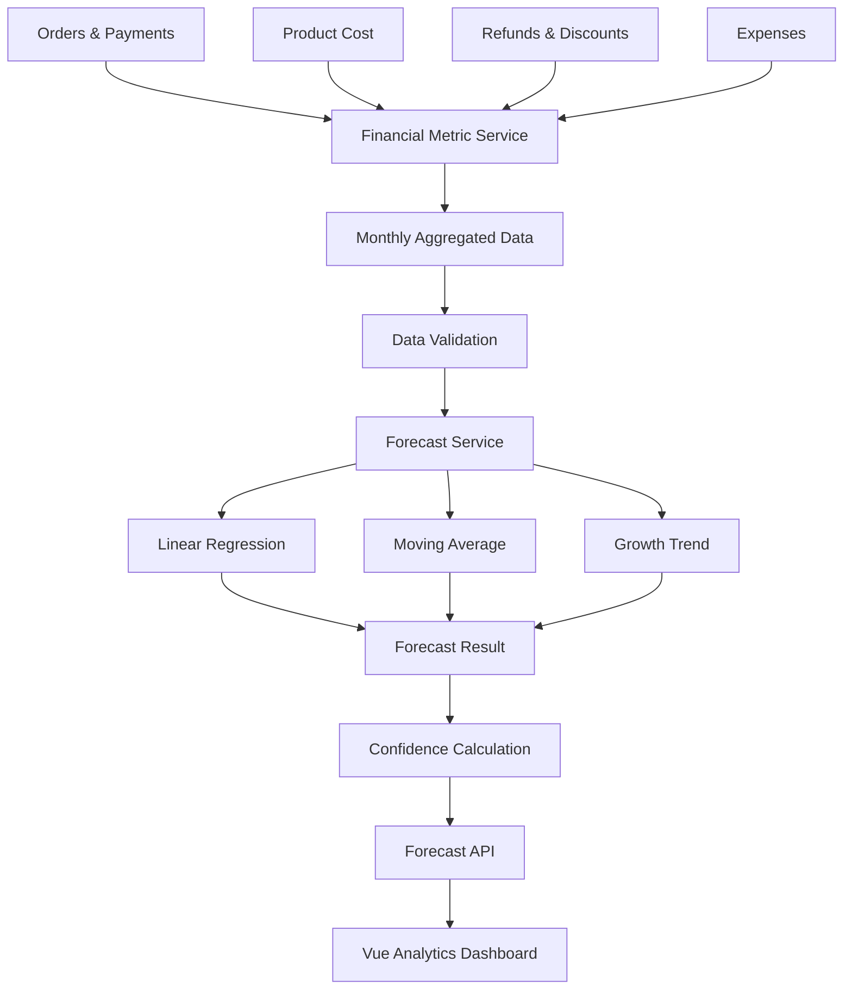

# E-KHMER Business Profit Prediction System

> **Project:** E-KHMER Multi-Vendor Marketplace  
> **Feature:** Business Profit Prediction / Forecasting  
> **Stack:** Laravel + Vue.js + MySQL + Redis + Docker  
> **Primary users:** Super Admin, Shop Owner, Shop Manager  
> **Status:** Version 1 implemented (26 October 2026). See [Implementation Record](#31-version-1-implementation-record) for the authoritative formulas, API contracts, tests, and limitations. Sections describing optional automation and advanced models remain the roadmap.

---

## Table of Contents

1. [Feature Overview](#1-feature-overview)
2. [Business Goal](#2-business-goal)
3. [Prediction Concept](#3-prediction-concept)
4. [Example Data](#4-example-data)
5. [Prediction Scope](#5-prediction-scope)
6. [Version 1 Recommendation](#6-version-1-recommendation)
7. [Data Sources](#7-data-sources)
8. [Financial Metrics](#8-financial-metrics)
9. [Prediction Methods](#9-prediction-methods)
10. [Confidence and Limitations](#10-confidence-and-limitations)
11. [Database Design](#11-database-design)
12. [Laravel Backend Architecture](#12-laravel-backend-architecture)
13. [API Design](#13-api-design)
14. [Vue Frontend Design](#14-vue-frontend-design)
15. [Super Admin Experience](#15-super-admin-experience)
16. [Shop Owner Experience](#16-shop-owner-experience)
17. [Dashboard UI Concept](#17-dashboard-ui-concept)
18. [Prediction Workflow](#18-prediction-workflow)
19. [Example Forecast](#19-example-forecast)
20. [Validation Rules](#20-validation-rules)
21. [Security and Shop Isolation](#21-security-and-shop-isolation)
22. [Caching and Performance](#22-caching-and-performance)
23. [Scheduled Forecast Generation](#23-scheduled-forecast-generation)
24. [Notifications and Alerts](#24-notifications-and-alerts)
25. [Testing and QA](#25-testing-and-qa)
26. [Implementation Phases](#26-implementation-phases)
27. [Definition of Done](#27-definition-of-done)
28. [Future Improvements](#28-future-improvements)
29. [Suggested File Structure](#29-suggested-file-structure)
30. [Coding Agent Prompt](#30-coding-agent-prompt)
31. [Version 1 Implementation Record](#31-version-1-implementation-record)

---

# 1. Feature Overview

The **Business Profit Prediction System** analyzes historical and current business performance and estimates future results.

```text
Past Business Data
        +
Current Business Data
        ↓
Data Cleaning
        ↓
Metric Calculation
        ↓
Trend Analysis
        ↓
Forecast Model
        ↓
Future Prediction
        ↓
Charts + Business Insights
```

The feature should help sellers understand:

- Whether profit is increasing or decreasing.
- Whether business growth is accelerating or slowing.
- Whether losses are becoming more serious.
- What may happen next month, quarter, or year.
- Which products or periods contribute most to profit.
- Whether the current trend suggests financial risk.

> Forecasts are decision-support estimates, not guaranteed financial results.

---

# 2. Business Goal

The feature should convert E-KHMER transaction history into useful business intelligence.

Example:

```text
Historical Data
2023
2024
2025

Current Data
2026

        ↓

Prediction
2027
2028
2029
```

Questions the system should help answer:

- How much profit may this shop generate next year?
- Is profit growth getting faster or slower?
- Are expenses increasing faster than revenue?
- Is the shop moving toward profit or loss?
- Which months perform best?
- Which products have weak margins?
- What happens if the current trend continues?

---

# 3. Prediction Concept

The system must calculate future estimates from real historical records.

```text
Orders
Payments
Refunds
Product Cost
Shipping Costs
Discounts
Expenses
Inventory Cost
        ↓
Financial Aggregation
        ↓
Monthly / Quarterly / Yearly Metrics
        ↓
Historical Dataset
        ↓
Forecasting Engine
        ↓
Predicted Metrics
```

For Version 1, prioritize simple and explainable forecasting over complex AI.

---

# 4. Example Data

Example business history:

| Year | Profit | Balance | Loss |
|---|---:|---:|---:|
| 2023 | $10,000 | $1,000 | $0 |
| 2024 | $15,000 | $1,100 | -$500 |
| 2025 | $20,000 | $900 | -$1,300 |
| 2026 | $22,000 | $950 | -$1,000 |

Possible forecast presentation:

| Year | Profit | Balance | Loss | Type |
|---|---:|---:|---:|---|
| 2023 | $10,000 | $1,000 | $0 | Actual |
| 2024 | $15,000 | $1,100 | -$500 | Actual |
| 2025 | $20,000 | $900 | -$1,300 | Actual |
| 2026 | $22,000 | $950 | -$1,000 | Current |
| 2027 | ~$26,000 | ~$930 | ~-$1,200 | Predicted |
| 2028 | ~$29,000 | ~$920 | ~-$1,250 | Predicted |

The predicted values above are examples only. Production output must come from actual data and the forecasting algorithm.

---

# 5. Prediction Scope

Version 1 should support:

```text
Revenue Prediction
Profit Prediction
Expense Prediction
Loss Prediction
Order Volume Prediction
Average Order Value Prediction
```

Optional later:

```text
Balance / Cash Position
Product Sales Prediction
Category Sales Prediction
Inventory Demand Prediction
Shop Growth Prediction
```

Recommended priority:

```text
1. Revenue
2. Profit
3. Expenses
4. Loss
5. Orders
6. Average Order Value
```

---

# 6. Version 1 Recommendation

Do not begin with a complex machine-learning platform.

Start with:

```text
Historical Marketplace Data
        ↓
Monthly Aggregation
        ↓
Trend Calculation
        ↓
Moving Average
        +
Linear Regression
        ↓
Forecast
```

Forecast periods:

- Next month
- Next 3 months
- Next 6 months
- Next 12 months
- Next year

The UI must clearly distinguish:

```text
ACTUAL
CURRENT
PREDICTED
```

---

# 7. Data Sources

Use existing E-KHMER records where available:

```text
orders
shop_orders
order_items
payments
payment_transactions
products
product_variants
inventories
inventory_transactions
coupons
coupon_usages
shipments
returns
refunds
```

Before implementation, inspect the actual migrations and business logic.

Do not create duplicate financial records when existing tables already provide the source of truth.

---

# 8. Financial Metrics

## 8.1 Revenue

```text
Net Merchandise Revenue = Shop Subtotal - Allocated Discount - Merchandise Portion of Verified Refunds
```

Do not count:

- Cancelled orders
- Failed payments
- Duplicate payments
- Fully refunded sales

## 8.2 Cost of Goods Sold

```text
COGS = Historical Purchase Cost × Quantity Sold
```

Use historical cost snapshots if available.

Do not calculate an old order's profit using today's product cost.

## 8.3 Gross Profit

```text
Gross Profit = Revenue - COGS
```

## 8.4 Recorded Trading Profit

If all required expense data exists:

```text
Recorded Trading Profit =
Net Merchandise Revenue
- COGS
- Recorded Operating Expenses
```

Discounts and merchandise refunds are already deducted from revenue and must not be deducted a second time. Customer shipping charges and tax are excluded. Shop-paid shipping, fees, and other business costs must be entered in the expense ledger to be included. This measure is not complete company net profit; missing historical costs make profit unavailable rather than treating costs as zero.

## 8.5 Loss

Prefer deriving loss from net profit:

```text
Net Profit >= 0 → Profit
Net Profit < 0  → Loss
```

Example:

```text
Net Profit = -1,300
Displayed Loss = -$1,300
```

## 8.6 Balance

`Balance` must be defined before forecasting because it can mean:

- Shop wallet balance
- Cash balance
- Net cash flow
- Account balance
- Revenue minus expenses

Do not predict balance until one clear source of truth exists.

---

# 9. Prediction Methods

## 9.1 Linear Regression

Use a linear trend for stable historical data.

```text
y = mx + b
```

Where:

```text
x = time
y = business metric
m = trend slope
b = intercept
```

Example data:

```text
2023 → 10,000
2024 → 15,000
2025 → 20,000
2026 → 22,000
```

The model fits the trend and estimates the next period.

## 9.2 Moving Average

Useful for monthly data.

Example:

```text
January  = 8,000
February = 10,000
March    = 12,000
```

3-month moving average:

```text
(8,000 + 10,000 + 12,000) / 3 = 10,000
```

## 9.3 Historical Growth Rate

```text
Growth Rate =
(Current - Previous) / Previous × 100
```

Example:

```text
2025 Profit = $20,000
2026 Profit = $22,000

Growth = 10%
```

## 9.4 Model Selection

Version 1 can compare:

```text
Linear Regression
Moving Average
Historical Growth Rate
```

Then use the model that behaves best against historical validation.

Do not label the feature as "AI" unless a real machine-learning model is actually implemented.

---

# 10. Confidence and Limitations

Every forecast should display a confidence level.

Possible levels:

```text
High
Medium
Low
```

Suggested interpretation:

### High

- 24+ months of clean data
- Stable trend
- Few missing periods

### Medium

- 12–23 months
- Moderate variation

### Low

- Less than 12 months
- Large fluctuations
- Missing periods

UI disclaimer:

> Forecasts are estimates based on historical marketplace data and are not guaranteed future results.

---

# 11. Database Design

Create dedicated forecast storage only if caching/history is useful.

Recommended table:

```text
business_forecasts
--------------------------------
id
shop_id
metric
period_type
forecast_for
predicted_value
lower_bound
upper_bound
confidence_score
model
data_points
generated_at
created_at
updated_at
```

Possible `metric` values:

```text
revenue
profit
expense
loss
orders
average_order_value
```

Possible `period_type` values:

```text
monthly
quarterly
yearly
```

Possible `model` values:

```text
linear_regression
moving_average
growth_rate
```

Optional forecast-run table:

```text
forecast_runs
--------------------------------
id
shop_id
forecast_type
date_from
date_to
forecast_horizon
model
status
generated_at
metadata
```

Only add this if historical forecast runs are valuable.

---

# 12. Laravel Backend Architecture

Recommended responsibilities:

```text
FinancialMetricService
        ↓
Calculate real historical metrics

ForecastDataService
        ↓
Prepare time-series data

BusinessForecastService
        ↓
Generate predictions

BusinessForecastController
        ↓
Expose APIs

BusinessForecastPolicy
        ↓
Authorization / shop isolation

GenerateBusinessForecast Job
        ↓
Optional background generation
```

Suggested files:

```text
app/
├── Http/Controllers/Api/BusinessForecastController.php
├── Models/BusinessForecast.php
├── Policies/BusinessForecastPolicy.php
├── Services/Analytics/
│   ├── FinancialMetricService.php
│   ├── ForecastDataService.php
│   └── BusinessForecastService.php
└── Jobs/GenerateBusinessForecast.php
```

Adapt to the existing repository structure.

---

# 13. API Design

Example seller endpoints:

```text
GET  /api/seller/shops/{shop}/analytics/overview
GET  /api/seller/shops/{shop}/analytics/history
GET  /api/seller/shops/{shop}/forecasts
POST /api/seller/shops/{shop}/forecasts/generate
```

Example:

```text
GET /api/seller/shops/12/forecasts?metric=profit&period=monthly&horizon=12
```

Possible response:

```json
{
  "success": true,
  "data": {
    "metric": "profit",
    "period": "monthly",
    "history": [
      {
        "period": "2026-08",
        "value": 12450,
        "type": "actual"
      },
      {
        "period": "2026-09",
        "value": 13120,
        "type": "actual"
      }
    ],
    "forecast": [
      {
        "period": "2026-11",
        "value": 14200,
        "lower_bound": 13100,
        "upper_bound": 15300,
        "type": "predicted"
      }
    ],
    "model": "linear_regression",
    "confidence": "medium"
  }
}
```

Never return another shop's private financial data.

---

# 14. Vue Frontend Design

Recommended seller navigation:

```text
Overview
Products
Stock
Orders
Payments
Analytics
  ├── Business Overview
  ├── Profit & Loss
  └── Predictions
Settings
```

Suggested route:

```text
/seller/shops/:shopId/analytics
```

or:

```text
/seller/shops/:shopId/predictions
```

Use the existing Vue Router convention if different.

---

# 15. Super Admin Experience

Super Admin can view marketplace-wide analytics.

Possible page:

```text
Super Admin
    ↓
Analytics
    ↓
Marketplace Forecast
```

Possible metrics:

```text
Marketplace Revenue
Marketplace Profit
Orders
Active Shops
Top Shops
Growth
Predicted Revenue
```

Filters may include:

```text
All Shops
Specific Shop
Category
Date Range
```

---

# 16. Shop Owner Experience

The shop owner only sees their own shop data.

Example cards:

```text
Current Profit
$22,000

Predicted Next Year
$26,000

Expected Growth
+18.2%

Confidence
Medium
```

---

# 17. Dashboard UI Concept

Recommended layout:

```text
┌─────────────────────────────────────────────────────────────┐
│ Business Analytics                          Last 12 Months   │
│ Understand your past performance and future trend.          │
└─────────────────────────────────────────────────────────────┘

┌──────────────┐  ┌──────────────┐
│ Revenue      │  │ Net Profit   │
│ $80,000      │  │ $22,000      │
│ +12.4%       │  │ +10.0%       │
└──────────────┘  └──────────────┘

┌──────────────┐  ┌──────────────┐
│ Expenses     │  │ Forecast     │
│ $58,000      │  │ $26,000      │
│ +8.1%        │  │ Next Year    │
└──────────────┘  └──────────────┘
```

Trend chart concept:

```text
Profit

30K |                         ·········● Predicted
    |                     ···
25K |                 ●···
    |              ●
20K |          ●
    |
15K |      ●
    |
10K |  ●
    +------------------------------------------------
       2023   2024   2025   2026   2027   2028

       ───── Actual
       ····· Predicted
```

Also provide a table:

```text
Year    Profit    Balance    Loss      Type
2023    10K       1K         0         Actual
2024    15K       1.1K       -500      Actual
2025    20K       900        -1.3K     Actual
2026    22K       950        -1K       Current
2027    26K       930        -1.2K     Predicted
```

---

# 18. Prediction Workflow



---

# 19. Example Forecast

Historical profit:

```text
2023 = $10,000
2024 = $15,000
2025 = $20,000
2026 = $22,000
```

Growth:

```text
2023 → 2024 = +50%
2024 → 2025 = +33.3%
2025 → 2026 = +10%
```

Growth is still positive, but slowing.

A trend-based forecast may estimate something similar to:

```text
2027 ≈ $26K
2028 ≈ $29K
```

The UI may show:

```text
Trend: Growing
Growth Speed: Slowing
Prediction Confidence: Medium
```

---

# 20. Validation Rules

Before forecasting, validate:

```text
Enough historical periods?
Missing months?
Duplicate transactions?
Cancelled orders excluded?
Refunds handled correctly?
Currency consistent?
Payment status correct?
Order status correct?
Product cost available?
```

If the dataset is insufficient, return:

```text
Prediction unavailable
```

or:

```text
Low confidence
```

Do not produce a misleading forecast just because the endpoint was called.

---

# 21. Security and Shop Isolation

Critical multi-vendor rule:

```text
Shop A
    ↓
Forecast only Shop A data

Shop B
    ↓
Forecast only Shop B data
```

A seller must never access:

```text
/api/seller/shops/OTHER_SHOP_ID/forecasts
```

Laravel must enforce:

```text
Authentication
+
Role Authorization
+
Shop Membership
+
Shop Ownership
```

Do not rely only on Vue route guards.

---

# 22. Caching and Performance

Analytics can become expensive.

Recommended flow:

```text
Raw Transactions
        ↓
Aggregate
        ↓
Cache
        ↓
Dashboard
```

Possible cache keys:

```text
shop:{shopId}:analytics:monthly
shop:{shopId}:forecast:profit:12
```

Refresh/invalidate after important financial changes such as:

```text
Order completed
Refund completed
Payment status changed
Financial correction
```

Never cache multiple shops under an unsafe shared key.

---

# 23. Scheduled Forecast Generation

Forecasts do not need to regenerate on every page request.

Recommended frequency:

```text
Daily
or
Weekly
```

Possible scheduler flow:

```text
GenerateBusinessForecast
        ↓
All Active Shops
        ↓
Refresh Forecast Cache / Records
```

For an initial small version, on-demand generation with caching is acceptable.

---

# 24. Notifications and Alerts

Optional seller alerts:

```text
Profit is predicted to decrease next month.
Expenses are increasing faster than revenue.
Predicted product demand is higher than current inventory.
Profit forecast improved by 15%.
```

Do not notify on normal small fluctuations.

The existing Telegram monitoring system can later be used for important business anomalies if appropriate.

---

# 25. Testing and QA

## Unit Tests

Test:

```text
Revenue calculation
COGS calculation
Profit calculation
Growth rate
Moving average
Linear regression
Confidence score
```

## Feature Tests

Test:

```text
Seller can view own forecast
Seller cannot view another shop forecast
Super Admin follows marketplace authorization
Customer cannot access seller analytics
Invalid date range rejected
Invalid forecast horizon rejected
```

## Data Edge Cases

Test:

```text
No orders
1 month of data
3 months of data
12+ months of data
Missing month
Cancelled order
Refunded order
Failed payment
Duplicate payment
Negative profit
Zero revenue
```

## Forecast Behavior

Increasing trend:

```text
10, 15, 20, 25
```

Expected:

```text
Positive increasing forecast
```

Decreasing trend:

```text
30, 25, 20, 15
```

Expected:

```text
Decreasing forecast
```

Stable trend:

```text
10, 10, 10, 10
```

Expected:

```text
Approximately stable forecast
```

Avoid brittle tests that require an exact prediction unless the algorithm mathematically guarantees it.

---

# 26. Implementation Phases

## Phase 1 — Financial Analytics Foundation

Implement:

```text
Revenue
COGS
Profit
Loss
Expenses
Historical Charts
Monthly Aggregation
```

Definition of done:

```text
[x] Metrics come from real database data
[x] Seller data is shop-isolated
[x] Refund/cancelled handling verified
[x] Dashboard displays historical data
```

## Phase 2 — Basic Prediction

Implement:

```text
Linear Regression
Moving Average
Growth Rate
Forecast API
Confidence Score
```

Definition of done:

```text
[x] Forecast uses real historical data
[x] Actual and predicted data are separated
[x] Low-quality data produces low confidence
```

## Phase 3 — Prediction Dashboard

Implement:

```text
Prediction Cards
Trend Charts
Actual vs Forecast Chart
Forecast Period Selector
Metric Selector
Business Insights
```

## Phase 4 — Automation

Implement:

```text
Scheduled Forecast Generation
Caching
Forecast History
Notifications
```

## Phase 5 — Advanced Prediction

Optional future:

```text
Seasonality
Product Demand Forecasting
Category Forecasting
Shop Risk Scoring
Advanced Time-Series Models
Machine Learning
```

---

# 27. Definition of Done

```text
[x] Historical metrics use real shop data
[x] Revenue formula is documented
[x] Profit formula is documented
[x] Refunds and cancellations are handled
[x] Forecast service works
[x] Seller can view own predictions
[x] Seller cannot view another shop's predictions
[x] Super Admin follows authorization rules
[x] Actual and predicted values are visually different
[x] Confidence level is displayed
[x] Forecast disclaimer is displayed
[x] Monthly/yearly views work
[x] Invalid input is validated
[x] Empty data states work
[x] Loading states work
[x] API errors are handled safely
[x] Automated tests exist
[x] Queries are batched and the query budget is tested
[x] No private financial data leaks across shops
```

---

# 28. Future Improvements

After Version 1 is stable:

```text
Sales Seasonality Detection
Revenue Forecast by Product
Revenue Forecast by Category
Inventory Demand Prediction
Low-Stock Prediction
Best-Selling Product Prediction
Slow-Moving Product Prediction
Customer Purchase Prediction
Return/Refund Risk Prediction
Shop Growth Score
Business Health Score
Expense Anomaly Detection
Profit Goal Planning
What-If Simulation
```

Example what-if simulations:

```text
What if sales increase by 10%?
What if product cost increases by 5%?
What if shipping cost increases by $1 per order?
What if discount usage decreases?
```

This can eventually become a full **Business Intelligence & Forecasting Module**.

---

# 29. Suggested File Structure

Adapt this to the actual E-KHMER repository.

```text
backend/
├── app/
│   ├── Http/Controllers/Api/BusinessForecastController.php
│   ├── Models/BusinessForecast.php
│   ├── Policies/BusinessForecastPolicy.php
│   ├── Services/Analytics/
│   │   ├── FinancialMetricService.php
│   │   ├── ForecastDataService.php
│   │   └── BusinessForecastService.php
│   └── Jobs/GenerateBusinessForecast.php
├── database/migrations/
│   └── *_create_business_forecasts_table.php
└── tests/
    ├── Unit/BusinessForecastServiceTest.php
    └── Feature/BusinessForecastApiTest.php

frontend/
└── src/
    ├── pages/seller/analytics/BusinessPrediction.vue
    ├── components/analytics/
    │   ├── ForecastMetricCard.vue
    │   ├── ProfitForecastChart.vue
    │   ├── HistoricalComparisonTable.vue
    │   └── ForecastConfidenceBadge.vue
    └── services/forecastApi.js
```

---

# 30. Coding Agent Prompt

Use this prompt to implement the feature:

```text
Act as a senior Laravel + Vue.js + MySQL Data Analytics Engineer.

I have an existing E-KHMER multi-vendor marketplace.

I want to add a Business Profit Prediction feature.

IMPORTANT:
Do not rebuild existing modules.
First inspect the actual repository, migrations, financial logic, order statuses,
payments, refunds, inventory, product cost fields, policies, routes and Vue architecture.

The feature must calculate historical financial metrics from existing real marketplace
data and forecast future values.

Main metrics:
- Revenue
- Profit
- Loss
- Expenses
- Orders
- Average Order Value

Primary users:
- Super Admin
- Shop Owner
- Shop Manager

Critical rule:
Shop A financial data must never be accessible to Shop B.

WORKFLOW:
INSPECT
→ MAP FINANCIAL DATA
→ DEFINE METRICS
→ TEST HISTORICAL CALCULATIONS
→ IMPLEMENT FORECAST SERVICE
→ IMPLEMENT API
→ IMPLEMENT UI
→ SECURITY TEST
→ PERFORMANCE TEST
→ REGRESSION TEST

Version 1 prediction methods:
1. Linear regression
2. Moving average
3. Historical growth rate

Do not call the system AI unless machine learning is actually implemented.

The UI must clearly distinguish:
ACTUAL
CURRENT
PREDICTED

Every forecast should show:
- metric
- forecast period
- predicted value
- trend
- growth percentage
- confidence level
- historical comparison

Add a visible disclaimer:
"Forecasts are estimates based on historical marketplace data and are not guaranteed future results."

Before implementing profit forecasting, determine the repository's actual source of truth for:
- successful sales
- product cost
- refunds
- discounts
- shipping costs
- operating expenses

Never invent missing financial data.

If required information is not recorded, document the limitation and either:
1. implement the missing accounting source safely, or
2. exclude it from the metric and clearly document the calculation.

Recommended architecture:
FinancialMetricService
ForecastDataService
BusinessForecastService
BusinessForecastController
BusinessForecastPolicy

Optional:
GenerateBusinessForecast Job

Create a dedicated forecast persistence table only if caching/history requires it.

Frontend seller route:
/seller/shops/:shopId/analytics
or adapt to the existing Vue Router structure.

Dashboard should include:
- Revenue
- Profit
- Expenses
- Growth
- Predicted Profit
- Forecast Confidence
- Historical vs Predicted chart
- Monthly / Quarterly / Yearly selector

Security tests must include:
- Shop A cannot request Shop B forecast
- Customer cannot access seller analytics
- Shop Manager permissions work
- Super Admin permissions work
- API cannot accept arbitrary shop ownership from frontend

Testing must cover:
- no data
- insufficient data
- stable trend
- increasing trend
- decreasing trend
- negative profit
- refunds
- cancellations
- failed payments
- duplicate payments
- missing months

Do not mark the feature complete until:
backend works
+
financial calculations are correct
+
forecast works
+
frontend works
+
shop isolation works
+
tests pass
+
actual/predicted values are clearly separated.

At the end update/create:
docs/BUSINESS_PROFIT_PREDICTION.md

Document:
- architecture
- formulas
- data sources
- APIs
- UI
- tests
- limitations
- implementation decisions
- future improvements
```

---

# Final Recommendation

Build the feature in this order:

```text
Correct Historical Financial Analytics
            ↓
Simple Explainable Forecasting
            ↓
Business Prediction Dashboard
            ↓
Automation
            ↓
Advanced AI/ML Later
```

Do not start with complicated machine learning.

First make sure these values are correct:

```text
Revenue
Profit
Expenses
Refunds
Inventory Cost
```

A sophisticated forecasting model using incorrect financial data will still produce incorrect business predictions.

The strongest Version 1 is:

```text
Correct Financial Data
+
Simple Explainable Forecast
+
Clear Dashboard
+
Shop Isolation
+
Confidence Indicator
```

---

# 31. Version 1 Implementation Record

Implemented on **26 October 2026**. This section describes shipped behavior; the earlier examples are illustrative and the optional phases remain a roadmap.

## Architecture and entry points

- `FinancialMetricService` loads settled shop orders, item snapshots, verified refunds, restocked returns, and operating expenses in bounded Eloquent batches. It accumulates money in integer cents.
- `ForecastDataService` groups monthly source records into monthly, quarterly, or calendar-year periods, fills internal zero-activity gaps, and identifies current/partial periods.
- `ForecastEngine` is a dependency-free statistical engine. `BusinessForecastService` prepares trailing usable history, applies model selection, derives signed losses, and caches the response.
- `BusinessForecastPolicy`, Sanctum, the existing admin middleware, and the existing active shop-manager middleware enforce access before reading financial data.
- `BusinessForecastController` and `BusinessExpenseController` expose resources through the existing API conventions.
- Both `/admin/analytics` and `/seller/shops/:id/analytics` render `BusinessAnalyticsView.vue` inside the existing shared dashboard template. Navigation, English/Khmer copy, dark mode, loading, retry, empty, and unavailable states are included.

## Accounting sources and exact definitions

| Measure | Source and calculation |
|---|---|
| Eligible sale | A `shop_orders` allocation and its parent order must be beyond pending/cancelled. The parent must have paid/partially-refunded/refunded payment state and a completed/refunded payment. Soft-deleted parent orders are excluded, matching existing reports. |
| Net merchandise revenue | Allocated `subtotal - discount_amount`, less the merchandise portion of verified `payment_refunds`. Customer shipping and tax are excluded. |
| Refund allocation | Item-linked refunds stay with the allocation containing that item. Their tax component is removed proportionally using net goods / (net goods + tax). Non-item Bakong refunds stay with the referenced shop order and use net goods / allocation total. Legacy cash refunds without an item reference are proportionally allocated using net goods / parent total. Refund reductions are capped at the original net goods amount. |
| Fully refunded sales | Revenue and retained order count become zero. The canonical fully-refunded parent state also excludes merchandise revenue for legacy refunds. Unrecovered inventory cost can still produce a loss. |
| COGS | `order_items.unit_cost × (sold quantity - refunded AND restocked quantity)`. Non-restocked returned goods retain their cost as a write-off. Null costs or missing item snapshots make aggregate COGS/profit/loss unavailable. Explicit zero cost remains a valid recorded value. |
| Operating expenses | Sum of non-deleted `business_expenses.amount` in the selected currency/date range. These are manually recorded costs, not an assertion that all real-world expenses are present. |
| Recorded profit | Net merchandise revenue - COGS - recorded operating expenses. Discounts/refunds are never subtracted twice. |
| Signed loss | `min(recorded profit, 0)`; unavailable if profit is unavailable. Loss forecasts are derived from the underlying profit forecast rather than fitted independently. |
| Orders | Number of settled shop-order allocations retaining positive net merchandise revenue. A multi-shop parent can contribute one order per shop; this differs intentionally from the parent-order count on the admin dashboard. |
| Average order value | Net merchandise revenue / retained shop-order count; unavailable at zero orders. The forecast card averages projected order values instead of adding them. |
| Marketplace view | Aggregate recorded trading results across shops. It is not platform commission income, cash balance, or company net profit. The existing commission percentage is a reference field and is not treated as earned income. |

**Date basis:** sales and their subsequent verified refunds are attributed to the original order placement month. Historical figures are restated from the ledger known at generation time; they are not an immutable accounting close or an as-of reconstruction of past payment states. Expenses use their incurred date. USD and KHR are filtered separately with no exchange-rate conversion.

Legacy order items without a shop-order allocation are excluded and surfaced through a data-quality warning. No duplicate payment/transaction joins are used to compute sales.

## Schema and checkout changes

Migration: `2026_10_26_023144_add_cost_snapshots_and_business_expenses.php`.

1. Adds nullable `order_items.unit_cost`. New checkouts snapshot `product_variants.cost_price` alongside the existing immutable price/item snapshots. Costs remain hidden from customer order serialization. Subsequent catalog price/cost changes do not rewrite historical costs.
2. Adds `business_expenses`: shop, creator, incurred date, category, description, amount, currency, timestamps, and soft deletion. Composite indexing supports shop/currency/date filtering. Categories are rent, payroll, shop-paid shipping, marketing, fees, and other.
3. Existing order costs are intentionally **not backfilled from today's catalog**. Older profit can remain unavailable. There is no invented cost correction or fabricated demo history in production.

The cost snapshot represents the seller's recorded variant cost at checkout, not inventory-lot/FIFO accounting. No forecast persistence table is needed for this on-demand, cached version.

## API contracts

All routes require Sanctum authentication.

| Endpoint | Access / behavior |
|---|---|
| `GET /api/seller/shops/{shop}/forecasts` | Active owner/manager of that shop. Query-string or body shop ownership cannot override the route context. |
| `POST /api/seller/shops/{shop}/forecasts/generate` | Same access; bypasses the cached result, limited to 10 calls/minute. |
| `GET /api/seller/shops/{shop}/analytics/overview` | Same forecast/summary resource for the shop. |
| `GET /api/seller/shops/{shop}/analytics/history` | Same resource, including historical metrics. |
| `GET /api/admin/forecasts` | Super Admin; all shops or an optional existing `shop_id`. |
| `POST /api/admin/forecasts/generate` | Super Admin; forced refresh, limited to 10 calls/minute. |
| `GET /api/admin/analytics/overview` and `/history` | Same marketplace/selected-shop resource. |
| `GET/POST /api/seller/shops/{shop}/expenses` | Paginated ledger / create expense for the authorized route shop. |
| `PUT/DELETE /api/seller/shops/{shop}/expenses/{expense}` | Update / soft-delete within the authorized shop; another shop's expense returns 404. |
| `GET/POST /api/admin/expenses` | Super Admin; list all/selected shops, or create with an explicit shop. |
| `PUT/DELETE /api/admin/expenses/{expense}` | Super Admin correction / soft-delete. Optional shop context is enforced when supplied. |

Forecast parameters:

- `metric`: revenue, profit (default), expense, loss, orders, average_order_value.
- `period`: monthly (default), quarterly, yearly.
- `horizon`: integer 1–12 **selected calendar periods**, default 3. Next year is `period=yearly&horizon=1`.
- `from`, `to`: valid ordered ISO dates, not in the future, covering at most 60 months. Default: current month plus the preceding 35 months through today.
- `currency`: USD (default) or KHR. No mixed-currency totals.
- `shop_id`: admin filter only; seller middleware replaces it with the validated route shop.

The response uses `{ "data": ... }` and includes scope, filters, historical metrics, selected historical values, forecast values/ranges, status, model, confidence indicator, training points, backtest MAE, period change, trend, growth speed, warnings, and generation time. Unavailable financial values are JSON `null`.

Expense writes require positive amounts with at most two decimal places, an existing shop context, a valid category, a description up to 500 characters, supported currency, and a non-future incurred date. Shop/creator assignments are server-controlled. Delete retains the row for audit; V1 does not retain every prior edited value.

## Forecast behavior and confidence

- Requires at least **three consecutive complete, usable selected periods**. Missing-cost or undefined-AOV periods reset the usable run; zero-activity months inside known history remain zero rather than disappearing.
- Current and boundary-partial periods are displayed but excluded from training. The model steps across any excluded period before predicting the requested future calendar periods, so a November prediction trained through September uses a two-step forecast. Empty history is not padded into a confident forecast.
- Linear regression, the mean of the last three periods, and positive-series historical growth are compared using rolling one-step historical MAE over up to the last 12 validation points. Growth uses the median historical rate, bounded to ±50% per period to limit unstable extrapolation.
- Three-point history has no holdout and falls back to a moving average with low confidence. With more history, the lowest validated MAE wins. Revenue, expenses, orders, and order value remain nonnegative; profit may be negative. Order estimates are rounded to whole orders.
- Confidence is an **ordinal data-quality indicator**, not a probability: high requires 24+ complete points and normalized MAE ≤15%; medium requires 12+ and ≤35%; otherwise low. A horizon exceeding the training length forces low confidence.
- Indicative bounds widen by `1.5 × historical absolute error × sqrt(steps ahead)`; pre-holdout data uses variation as fallback. These are illustrative uncertainty ranges, not calibrated confidence intervals. Perfectly stable validated data can have zero range width.
- Other selected metrics are forecast independently; their outputs do not constitute a reconciled future accounting statement. The summary forecast sums additive metrics; average order value is averaged; loss is derived from profit.
- Growth percentages use the absolute prior value as the denominator, with no percentage at a zero baseline. Trend/acceleration describe the observed complete periods, not financial advice.

The visible disclaimer remains: **“Forecasts are estimates based on historical marketplace data and are not guaranteed future results.”**

## Caching, performance, and operations

Uses the configured Laravel cache store, compatible with Redis. Keys contain explicit marketplace/shop scope, every forecast parameter, the current date, and a financial-data revision; results expire after five minutes. Relevant order, item, shop-order, payment, refund, return, and expense model events invalidate the revision **after transaction commit**. Forced refresh bypasses the cache. Bulk database updates bypassing Eloquent events can remain stale for at most the cache TTL unless explicitly refreshed.

Source queries use Eloquent relationships and 200-row chunks, not unbounded per-order queries. The API tests enforce a query budget with multiple orders. Expense pages contain 20 records. Admin shop search is server-backed so shops beyond the initial option list remain discoverable.

The development migration has been applied through Docker. Standard deployment requires the migration before serving the updated checkout/API code:

```text
docker compose exec app php artisan migrate --no-interaction
docker compose exec frontend npm run build
```

Daily/weekly pre-generation, historical forecast-run persistence, Telegram alerts, balance prediction, seasonality, demand forecasting, and advanced ML remain optional future work. No notification is sent by this feature and no external model/API dependency is introduced.

## Validation and regression checks

```text
docker compose exec app php artisan test --compact tests/Unit/ForecastEngineTest.php tests/Feature/BusinessForecastApiTest.php tests/Feature/Api/CheckoutTest.php
docker compose exec frontend npm run build
docker compose run --rm browser-tests npx playwright test business-analytics.spec.ts
```

Validation result: **94 backend tests / 493 assertions passed**, including the existing checkout, seller workspace, and admin dashboard suites; **8 analytics browser tests passed** on desktop/mobile. The Vue production build and the MySQL development migration passed. Pint was run successfully with the explicit changed PHP paths: its Git-based `--dirty` option is unavailable inside this container because the repository metadata is outside the mounted backend directory.

Coverage includes forecast trends and negative profit; insufficient/empty data; gaps and current/partial periods; all three period views; discounts and tax/shipping separation; partial/full refunds and unrecovered-stock loss; cross-shop gateway refunds; failed/cancelled sales; duplicate payment transactions; supported currency separation; snapshot privacy and stability after catalog edits; role/membership isolation and forged ownership; invalid forecast parameters; expense create/edit/delete and cache refresh; query counts; UI filters, retry, expense validation/confirmation, HTML escaping, English/Khmer, dark mode, and desktop/mobile overflow.

## Remaining limitations and next improvements

1. Older missing cost snapshots cannot be reconstructed reliably from current catalog costs. An audited historical correction/import workflow would need separate design and verified source documents.
2. Recorded expenses may be incomplete. This feature reports recorded trading profit, with an explicit warning; it does not certify full net profit or cash position.
3. Forecasts do not model promotions, stockouts, seasonality, exchange rates, tax accounting, inventory lots, or external market changes.
4. Revenue is a restated placement-date view rather than payment-date cash flow or a closed-period accounting ledger.
5. Start advanced forecasting only after sufficient real, complete history accumulates. Model labels remain statistical methods; this feature is not marketed as AI.
